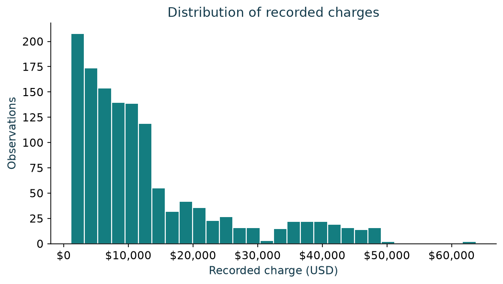
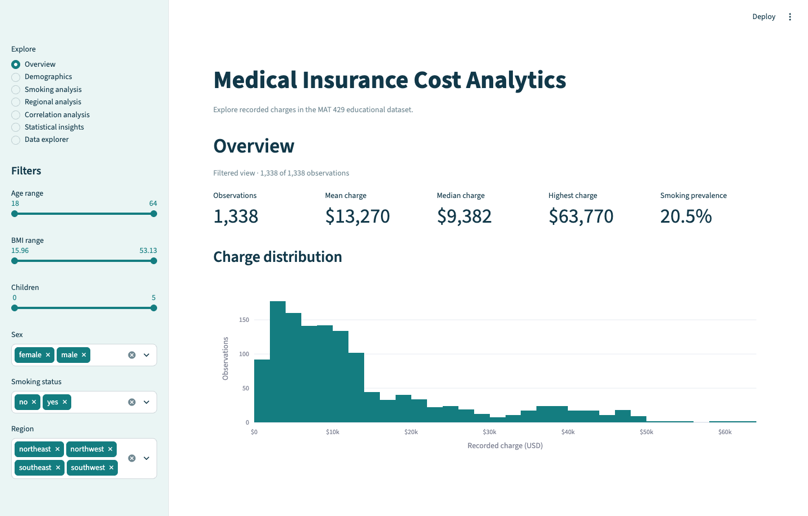

# Medical Insurance Cost Analytics

Analyze charge distributions across 1,338 educational medical insurance records. R and Python compare means, medians, and upper tails, while DuckDB and Streamlit support SQL queries and interactive exploration.

## Findings

| Question | Result |
| --- | --- |
| How do charges differ by smoking status? | Median charges were **$34,456** for smokers and **$7,345** for nonsmokers. The $27,111 difference had a 95% bootstrap interval of $22,048 to $28,866. The rank-biserial effect was 0.949. |
| How do charges vary by sex? | The male mean was $1,387 higher and the medians were $43 apart. Welch p = 0.03584 and rank-sum p = 0.72865. |
| Is there a regional difference? | Ordinary ANOVA p = 0.03089, Welch ANOVA p = 0.05059, and Kruskal–Wallis p = 0.19233. Regional rank eta-squared was 0.0013. |
| Which numeric variables are associated with charges? | Spearman rho was 0.534 for age, 0.119 for BMI and 0.133 for covered children. |

[Why the tests disagree](docs/KEY_FINDINGS.md) examines group sizes, skewness, differing spreads and upper-tail sensitivity. The R and Python pipelines agreed on all 17 compared test statistics and p-values and all 10 effect estimates.



## Dashboard

The Streamlit workspace includes overview, demographics, smoking, region, correlations, statistical insights and a searchable, sortable data explorer with CSV export. Age, BMI, sex, smoking status, region and children filters update descriptive metrics and charts. Inferential tables identify their full-dataset scope beside the results.



[Smoking analysis screenshot](docs/dashboard-smoking.png)

## Data and methods

The original dataset contains age, sex, BMI, children, smoker, region and charges. Validation found zero missing values, one exact repeat and 139 pooled IQR outliers. The primary analysis retained every row. See the [data dictionary and provenance](data/README.md) for access and redistribution details.

R uses tidyverse, ggplot2, dplyr, broom and rstatix for the academic replication and effect estimates. Python uses pandas, NumPy, SciPy and statsmodels for independent analyses and Matplotlib and Plotly for graphics. Both pipelines use descriptive summaries, Shapiro–Wilk, Wilcoxon rank-sum, Kruskal–Wallis, Bonferroni pairwise tests, Welch t-tests, ANOVA, Spearman correlations and seeded percentile bootstrap intervals. DuckDB stores a validated local snapshot and executes SQL segment and tail comparisons. Quarto builds the technical report.

- [Executive summary](reports/executive_summary.md)
- [Rendered HTML report](reports/analysis_report.html) · [PDF report](reports/analysis_report.pdf)
- [Technical methodology](docs/METHODOLOGY.md)
- [Academic audit](docs/PROJECT_AUDIT.md)
- [Statistical assumptions](docs/STATISTICAL_ASSUMPTIONS.md)
- [Cross-language test verification](results/statistical_tests/verification_tests.csv)

## Reproduce locally

Use Python 3.13, R 4.5.2 and Quarto with bundled Typst for PDF output. The project was exercised on arm64 macOS. Run commands from the repository root. Use your authorized CSV at `data/raw/insurance.csv` or export `INSURANCE_CSV` with the path to it.

```bash
python3.13 -m venv .venv
source .venv/bin/activate
python -m pip install -r requirements.txt

Rscript -e 'install.packages("renv", repos="https://cloud.r-project.org")'
Rscript -e 'renv::restore(prompt = FALSE)'
Rscript -e 'renv::load(); source("scripts/run_analysis.R")'

python -m scripts.build_database
export R_LIBS="$(Rscript -e 'cat(renv::paths$library())')"
python -m scripts.generate_report --render html
"${QUARTO_BIN:-quarto}" render reports/analysis_report.qmd --to typst
python -m streamlit run dashboard/app.py --server.address 127.0.0.1
```

Quarto is bundled with RStudio on macOS. If it is outside your PATH, set
`QUARTO_BIN` to its executable path. The report generator also accepts `--render pdf` to refresh the results and render the Typst PDF in one command. Outputs go to `results/` and `reports/`.

## SQL example

```sql
SELECT smoker,
       count(*) AS observations,
       avg(charges) AS mean_charge,
       median(charges) AS median_charge
FROM insurance
GROUP BY smoker
ORDER BY smoker;
```

See [the SQL collection](sql/) for smoking by age and BMI, regional summaries, demographic ranking, threshold exceedance and the highest-charge segment. The database builder also exports all query results as CSV.

## Tests

```bash
python -m pytest
ruff check python dashboard scripts tests
ruff format --check python dashboard scripts tests
Rscript -e 'renv::load(); source("tests/test_r.R")'
```

GitHub Actions runs Python, SQL, Streamlit component and R tests using synthetic fixtures. The test suite can run without the educational dataset.

## Limitations and future work

The sampling process and observation period are unknown. The data support educational comparisons of recorded charges. Confounding, limited demographic categories and unknown representativeness prevent causal, pricing or underwriting conclusions. Future work could validate the workflow on properly governed, documented samples and prespecify adjusted comparisons. See [Limitations](docs/LIMITATIONS.md).

## License and references

[License](LICENSE) · [Non-Parametric Analysis of Medical Insurance Charges](reports/original_report.pdf), Youssef Rafik, Southern Connecticut State University, Spring 2026.

- [Dataset attribution and links](data/README.md)
- [R statistical reference manual](https://stat.ethz.ch/R-manual/R-devel/library/stats/html/00Index.html)
- [SciPy statistics documentation](https://docs.scipy.org/doc/scipy/reference/stats.html)
