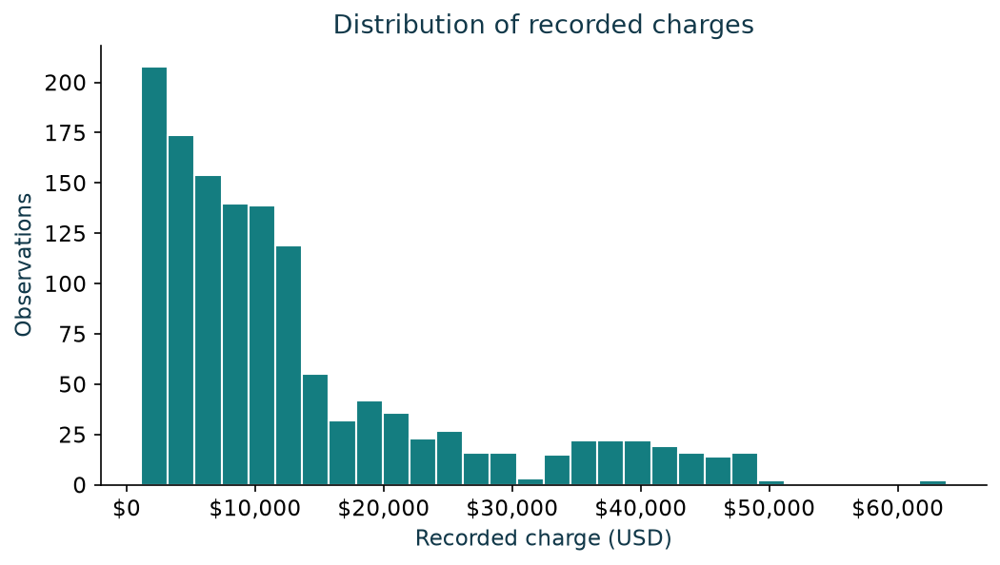
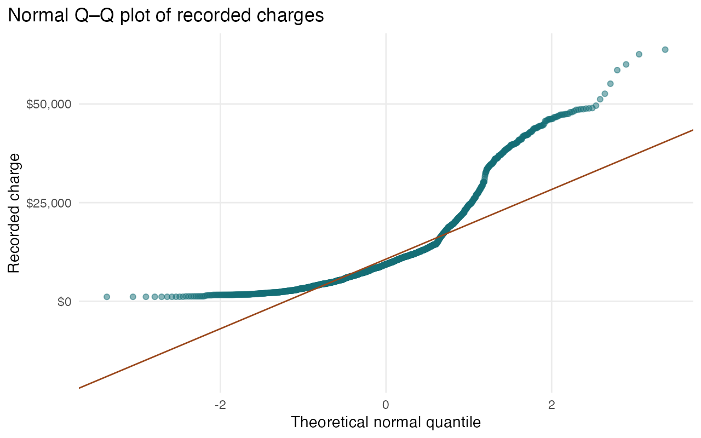
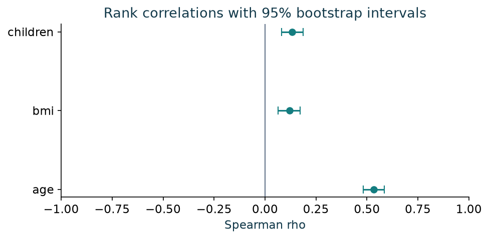
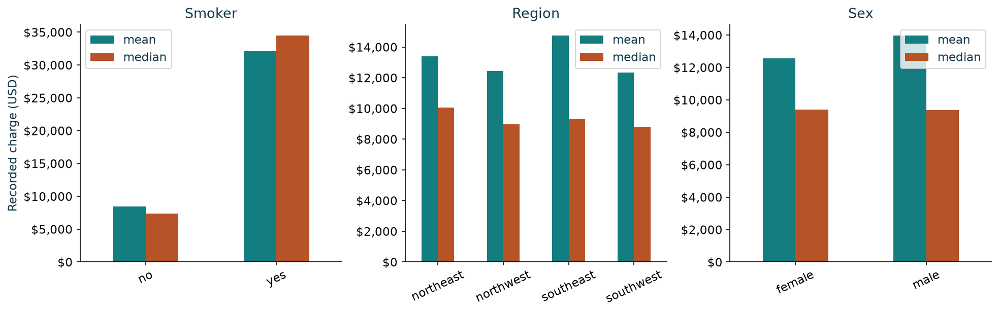

```{r}
#| include: false
tables <- "../results/tables"
stats <- "../results/statistical_tests"
read <- function(dir, name) read.csv(file.path(dir, paste0(name, ".csv")))
quality <- jsonlite::fromJSON(file.path(tables, "data_quality.json"))
group <- function(name) read(tables, paste0("python_", name))
tests <- read(stats, "python_tests")
effects <- read(stats, "python_effects")
fmt_p <- function(p) format.pval(p, digits = 4, eps = 0)
display_groups <- function(key) {
  data <- group(key)
  fields <- c("group", "n", "mean", "median", "sd", "skew", "tail_n", "smoker_share")
  names <- c("Group", "n", "Mean", "Median", "SD", "Skew", "Tail n", "Smoking share")
  knitr::kable(data[fields], digits = 3, col.names = names)
}
```

## Executive summary

Recorded smoking status had the strongest group association. The median charge
was `r scales::dollar(group("smoker")$median[group("smoker")$group == "yes"])`
among smokers and `r scales::dollar(group("smoker")$median[group("smoker")$group == "no"])`
among nonsmokers. Age had the strongest of the three rank correlations.
For sex and region, mean and rank tests addressed different questions and led
to different strength of evidence.

## Dataset and data quality

The educational CSV has `r format(quality$rows, big.mark=",")` observations and
seven fields. Age, BMI and covered children are numeric characteristics. Sex,
smoking status and region are categorical. Recorded billed charges are the
outcome. Validation found `r sum(unlist(quality$missing))` missing values and
`r quality$duplicate_rows_beyond_first` exact repeat beyond the first occurrence.
The pooled 1.5 × IQR rule flagged `r quality$iqr_outliers` observations.
All records were retained in the main analysis.

## Questions and statistical methodology

1. Do charges differ by smoking status?
2. Do charges differ across U.S. regions?
3. Do charges differ by sex?
4. Are age, BMI and number of covered children associated with charges?

The rank tests use a two-sided asymptotic approximation, with tie correction
and continuity correction for rank-sum. Kruskal–Wallis uses a tie-corrected
omnibus statistic. The six exploratory regional comparisons use Bonferroni
adjustment. Welch t-tests compare means. Ordinary ANOVA assumes equal group
variances, and Welch ANOVA allows them to differ. Spearman describes monotonic
association using average ranks. Observations are treated as independent.

## Exploratory analysis

{width=88%}

{width=85%}

```{r}
display_groups("smoker")
```

```{=typst}
#pagebreak(weak: true)
```

## Hypothesis tests

```{r}
shown <- tests
shown$p_value <- fmt_p(shown$p_value)
knitr::kable(shown, digits = 4, col.names = c("Test", "Statistic", "p-value"))
```

## Effect sizes and uncertainty

The directed comparisons are smokers minus nonsmokers and male minus female.
Intervals are seeded 95% percentile bootstrap intervals from 2,000 draws,
resampled within each group or as paired rows for correlations. Regional rank
eta-squared is a point estimate. These intervals are marginal and conditional
on the observed sampling structure.

```{r}
knitr::kable(effects[1:4], digits = 4, col.names = c("Effect", "Estimate", "Lower", "Upper"))
```

{width=88%}

## Why Parametric and Nonparametric Tests Disagree

```{r}
display_groups("sex")
```

```{r}
display_groups("region")
```

{width=100%}

The sex groups have nearly equal medians despite higher mean charges in the
male group. Their different tail counts, spreads and smoking proportions help
describe the divergence between those estimands. The southeast has the
highest regional mean and SD, while the northeast has the highest median.
A mean difference can be driven by upper-tail magnitudes, while a rank test
depends on how observations are ordered. The Welch regional p-value is close
to 0.05 and illustrates how equal-variance assumptions affect the benchmark.

```{r}
x <- read(stats, "sensitivity")
wide <- reshape(x[c("scenario", "n", "test", "p_value")], idvar = c("scenario", "n"),
                timevar = "test", direction = "wide")
knitr::kable(wide, digits = 4,
             col.names = c("Scenario", "n", "Sex rank", "Sex Welch",
                           "Region rank", "Region ANOVA", "Region Welch"))
```

The broad pattern persisted after collapsing the repeat and after capping
charges at the 95th percentile. Excluding pooled-fence exceedances attenuated
the sex mean result and strengthened the regional rank result. Exclusion
changes the analytic cohort and describes a different subset. These checks
are exploratory.

## Limitations and conclusion

Sampling, observation dates and the independence of records cannot be
verified. Confounding and omitted variables limit interpretation of these
unadjusted associations. The recorded sex labels and broad region labels also
limit fairness and generalizability assessments. The data provide an
educational example of comparing distributional and mean-based evidence.
They cannot establish causation or support operational insurance decisions.
